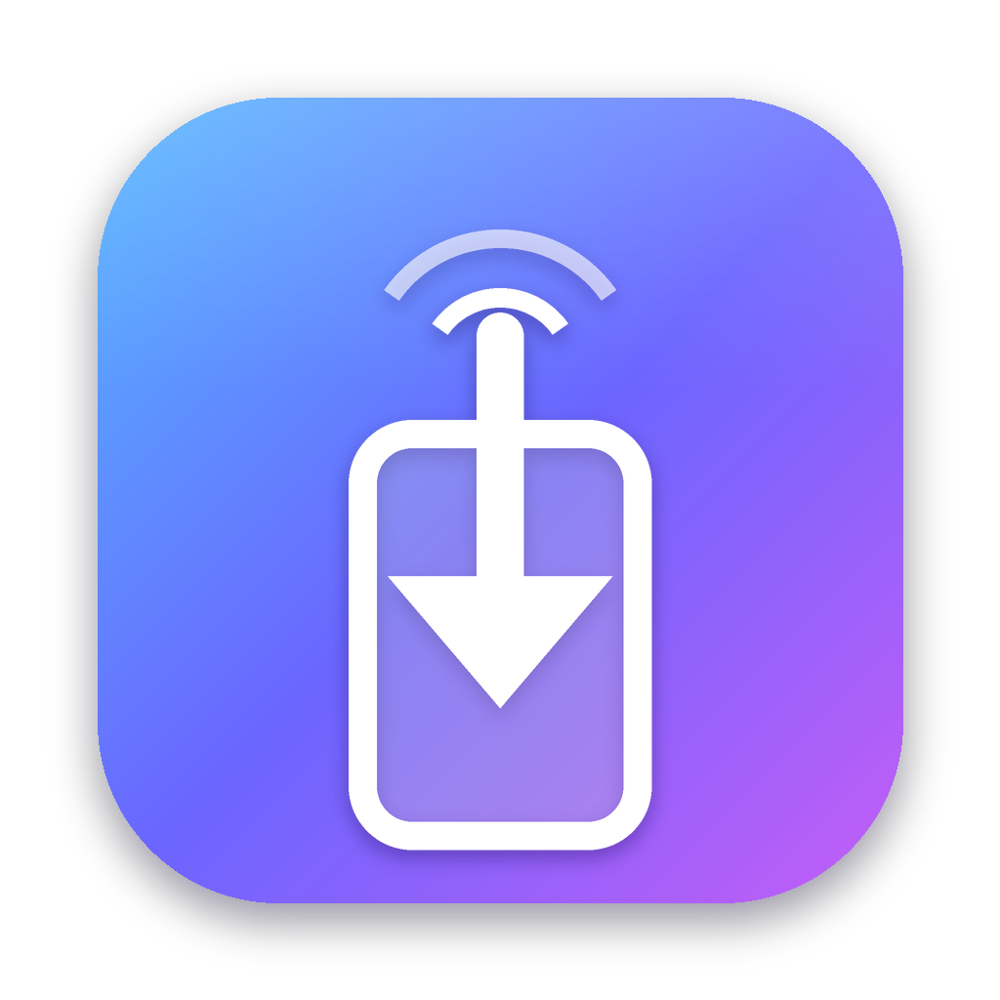
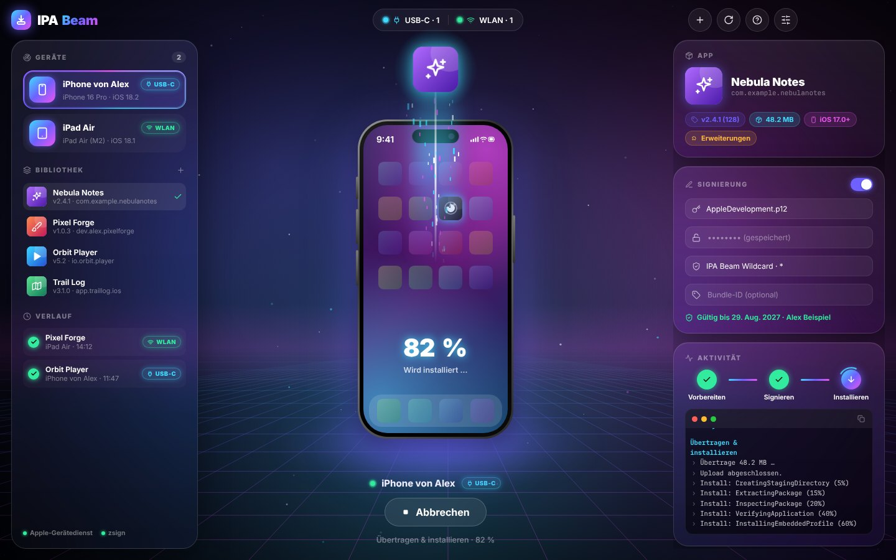
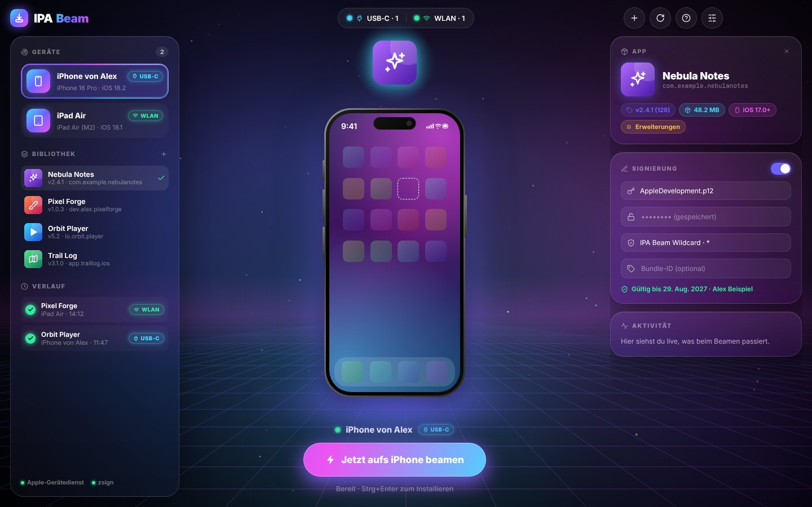
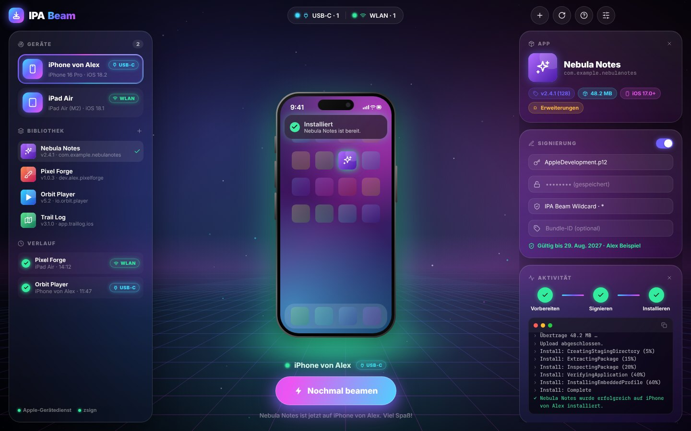
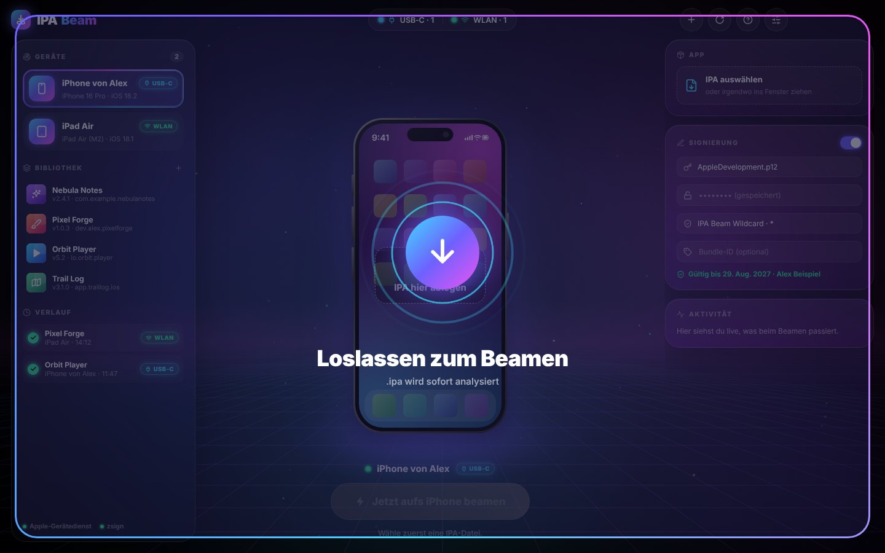
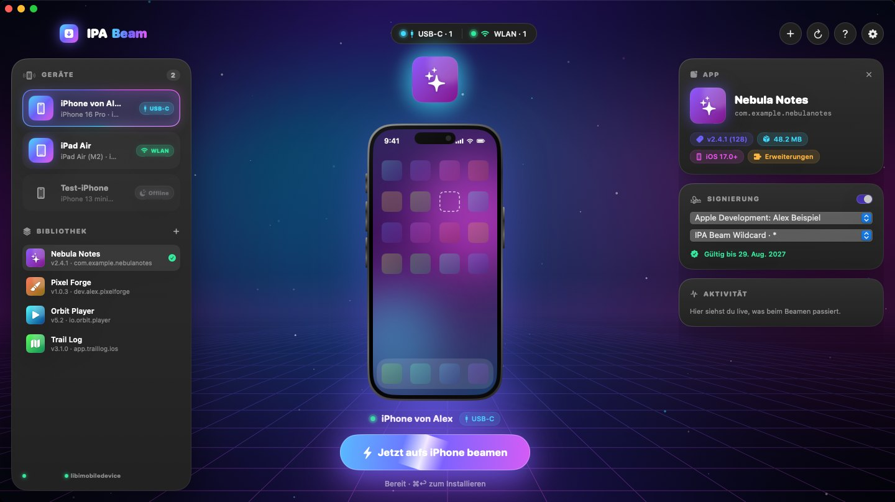
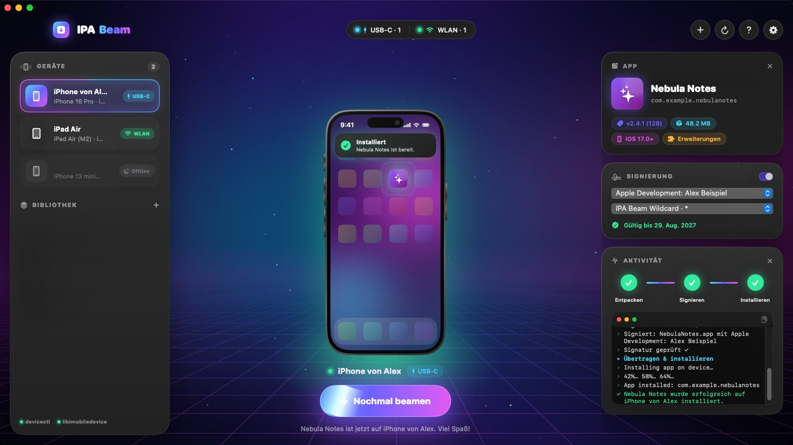
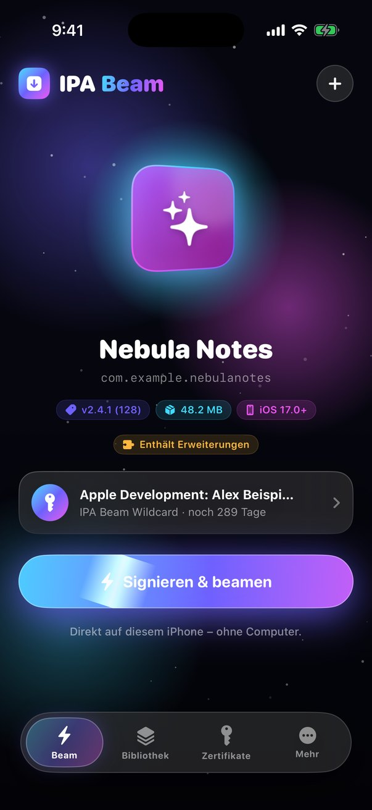
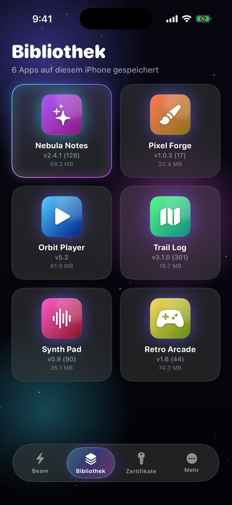
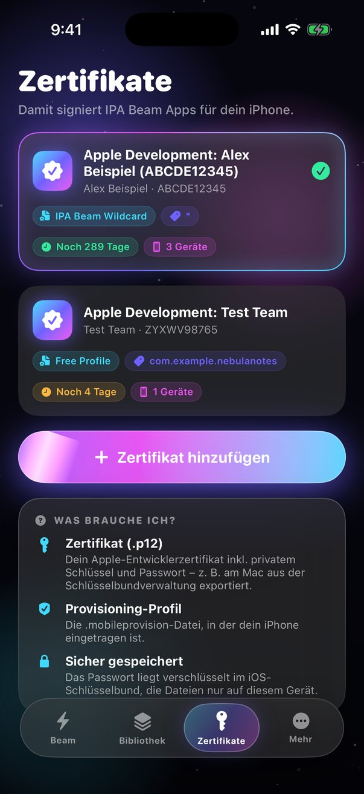

<p align="center">
  
</p>

<h1 align="center">IPA Beam</h1>
<p align="center"><b>IPA-Dateien per USB‑C oder WLAN aufs iPhone beamen – für Windows, macOS und als iPhone-App.</b></p>

<p align="center">
  
</p>

---

## 🖼️ Screenshots

| Bereit | App wird gebeamt |
|---|---|
|  |  |
| **Installiert** | **Drag & Drop** |
|  |  |

Native macOS-Version (SwiftUI):

| | |
|---|---|
|  |  |

iPhone-App (Stufe 1):

| Beam | Bibliothek | Zertifikate |
|---|---|---|
|  |  |  |

## 📱 iPhone-App (Ordner [`ios/`](ios))

- IPA aus Dateien, Safari, Mail oder AirDrop öffnen („Öffnen in IPA Beam“) – Icon, Name, Version werden angezeigt
- Bibliothek aller importierten IPAs (Teilen, Löschen)
- Zertifikat (.p12 + Passwort, sicher im iOS-Schlüsselbund) und Provisioning-Profil hinzufügen und prüfen
- **Noch nicht enthalten:** Signieren und Installieren direkt auf dem iPhone (nächste Stufe). Bis dahin installiert man Apps mit der PC/Mac-Version.
- Installation der iPhone-App selbst: Artefakt **IPA-Beam-iOS-unsigned** aus *Actions → Build iOS App* mit IPA Beam am PC/Mac (Neu signieren aktiv) aufs iPhone beamen.
- Selbst bauen: `cd ios && brew install xcodegen && xcodegen generate && open IPABeam.xcodeproj`

## 📦 Zwei Versionen

| | **IPA Beam Desktop** | **IPA Beam für Mac (nativ)** |
|---|---|---|
| Plattform | **Windows 10/11** und macOS | macOS 14+ |
| Technik | Electron, Ordner [`desktop/`](desktop) | SwiftUI, Ordner [`Sources/`](Sources) |
| iPhone-Verbindung | Apple-Gerätedienst (usbmuxd) direkt – **USB‑C & WLAN** | Apple `devicectl` (Xcode) oder libimobiledevice – **USB‑C & WLAN** |
| Signieren | Zertifikat **.p12** + **.mobileprovision** (via zsign) | Zertifikat aus dem Schlüsselbund + Profil (via codesign) |
| Download | Actions → **Build Desktop** → `IPA-Beam-Windows` / `IPA-Beam-Desktop-macOS` | Actions → **Build macOS App** → `IPA-Beam-macOS` |

## ✨ Funktionen

- **Drag & Drop** einer `.ipa` irgendwo ins Fenster, Doppelklick im Explorer/Finder oder Strg/⌘+O
- **3D-iPhone in der Mitte**, das der Maus folgt – die App wird per Lichtstrahl „hineingebeamt“, Fortschritt wie beim App‑Store‑Download direkt auf dem Homescreen
- **Automatische Geräteerkennung** über USB‑C und WLAN mit Verbindungs-Badge
- **App-Vorschau**: Icon, Name, Bundle‑ID, Version, Größe, minimale iOS‑Version (ohne Entpacken)
- **Neu signieren** mit eigenem Zertifikat & Profil, Prüfung ob dein iPhone im Profil steht
- **Live-Fortschritt**: Schritt-Timeline + Terminal‑Protokoll, verständliche Fehlermeldungen mit Lösungstipp
- **Bibliothek & Verlauf** der zuletzt verwendeten IPAs und Installationen

## 🪟 Windows – Einrichtung

1. **„Apple Devices“** aus dem Microsoft Store installieren (alternativ iTunes). Das liefert den Apple‑Gerätedienst, über den IPA Beam mit dem iPhone spricht.
2. `IPA-Beam-Setup-x.y.z.exe` (Installer) oder `IPA-Beam-Portable-x.y.z.exe` starten. Da die App nicht signiert ist, zeigt Windows evtl. „Der Computer wurde durch Windows geschützt“ → **Weitere Informationen → Trotzdem ausführen**.
3. iPhone per USB‑C anschließen, entsperren, **„Vertrauen“** tippen.
4. Auf dem iPhone **Entwicklermodus** aktivieren (Einstellungen → Datenschutz & Sicherheit).
5. **WLAN:** In „Apple Devices“ beim iPhone **„Dieses iPhone im WLAN anzeigen“** aktivieren – danach geht’s kabellos.

## 🍎 macOS – Einrichtung

- **Desktop-Version:** `.dmg` öffnen, App in *Programme* ziehen, beim ersten Start **Rechtsklick → Öffnen**.
- **Native Version:** `IPA-Beam.zip` entpacken, ebenso **Rechtsklick → Öffnen**. Nutzt Xcode (`devicectl`) oder `brew install libimobiledevice ideviceinstaller`.
- WLAN: Im Finder beim iPhone **„Dieses iPhone im WLAN anzeigen“** aktivieren (bzw. in Xcode „Connect via network“).

## ✍️ Signieren

iOS installiert nur Apps, die für dein Gerät signiert sind. Ist deine IPA das nicht:

- **Desktop (Windows/Mac):** Unter „Signierung“ dein Zertifikat als **.p12** (inkl. Passwort) und ein passendes **.mobileprovision** wählen. Das Passwort wird verschlüsselt im System-Schlüsselspeicher abgelegt. Optional eigene Bundle‑ID.
- **Native Mac-App:** In Xcode mit der Apple‑ID anmelden, einmal ein Projekt aufs iPhone starten – Zertifikat & Profil werden automatisch gefunden.

> Kostenlose Apple‑ID: Apps laufen 7 Tage. Mit bezahltem Developer Account (Wildcard‑Profil) 1 Jahr.

## 🛠️ Selbst bauen

```bash
# Desktop (Windows/macOS)
cd desktop
npm install
npm start                 # starten
npm run dist:win          # Windows-Installer + Portable (auf Windows)
npm run dist:mac          # macOS .dmg (auf macOS)
npm run screenshots       # Demo-Screenshots rendern

# Native macOS-App
./Scripts/build-app.sh    # erzeugt build/IPA Beam.app
```

## ⚠️ Hinweise

- **Verschlüsselte IPAs** (direkt aus dem App Store) lassen sich nicht installieren.
- Nutze die App nur für Apps, die du rechtmäßig verwenden darfst (eigene Apps, Open Source, Testbuilds).
- Verwendete Open-Source-Komponenten: [appium-ios-device](https://github.com/appium/appium-ios-device) (Apache‑2.0), [zsign](https://github.com/zhlynn/zsign), Schrift [Inter](https://rsms.me/inter/) (OFL).
